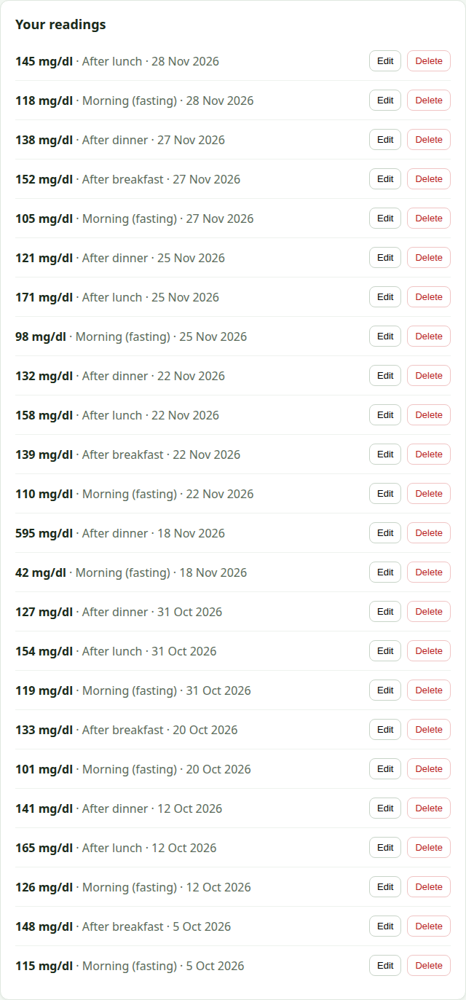
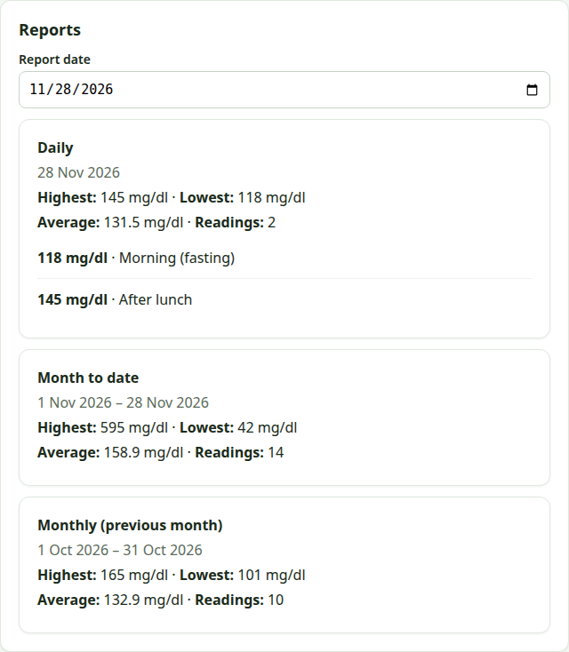
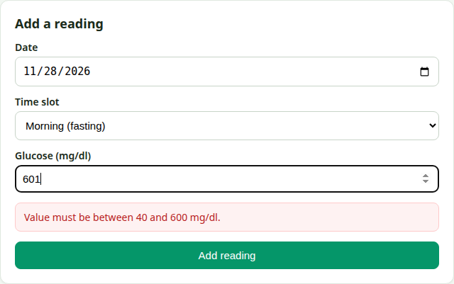

# Sweety — blood glucose tracker

Sweety is a small web app where a diabetes patient records up to 4 blood
glucose readings a day — Morning (fasting), After breakfast, After lunch,
After dinner — and views daily, month-to-date and monthly reports. It was
built as the Kenpath Junior Full Stack Developer assessment.

Features:

- Register and log in (passwords hashed with bcrypt, JWT sessions). After
  login, a user only ever sees their own readings.
- Add, view, edit and delete readings (date, time slot, value in mg/dl)
  with the exact validation messages from the assignment.
- Reports showing the highest, lowest and average reading (rounded to
  1 decimal) and the number of readings, with a friendly empty state when
  there are no readings: Daily, Month-to-date, and Monthly (the whole
  previous month).
- A seed script that creates a demo user with sample readings.

## Tech stack

- **API:** Node.js 20+ with Express 4
- **Database:** PostgreSQL 16 (`pg`, plain SQL — no ORM)
- **Frontend:** React 18 + Vite 5
- **Auth:** bcrypt password hashing, JSON Web Tokens
- **Tests:** Node's built-in test runner (`node:test`) + `fetch`, against a
  separate test database

## Prerequisites

- Node.js 20+ and npm
- PostgreSQL 16 running locally

## Install

```bash
git clone https://github.com/santhosh-d-projects/Sweety.git
cd Sweety

# Server
cd server
npm install

# Client (new terminal, from the repo root)
cd client
npm install
```

## Database setup

```bash
# Create the database user and database (one time)
sudo -u postgres psql -c "CREATE USER sweety WITH PASSWORD 'your-password';"
sudo -u postgres psql -c "CREATE DATABASE sweety OWNER sweety;"

# Create the test database (only needed to run `npm test`)
sudo -u postgres psql -c "CREATE DATABASE sweety_test OWNER sweety;"
```

Tables are created by the migration, which runs automatically every time
the server starts. You can also run it by hand:

```bash
cd server
npm run migrate
```

## Environment variables

Server variables live in `server/.env.example` (copy it to `server/.env`
and fill in real values); the client variable lives in
`client/.env.example` (copy to `client/.env`). No real secrets are
committed — the examples contain placeholders only.

| Variable | Where | Description |
| --- | --- | --- |
| `PORT` | server | Port the API listens on (default `5000`) |
| `CLIENT_URL` | server | Frontend origin allowed by CORS (default `http://localhost:5173`) |
| `DB_HOST` | server | PostgreSQL host (default `localhost`) |
| `DB_PORT` | server | PostgreSQL port (default `5432`) |
| `DB_NAME` | server | Database name (default `sweety`) |
| `DB_USER` | server | Database user (default `sweety`) |
| `DB_PASSWORD` | server | Database password |
| `JWT_SECRET` | server | Long random string used to sign JWTs. **Required** — the server refuses to start without it |
| `JWT_EXPIRES_IN` | server | How long login tokens last (default `7d`) |
| `TEST_DATABASE_URL` | server | Connection string for the test database, used by `npm test` only |
| `VITE_API_URL` | client | Base URL of the API (default `http://localhost:5000`) |

## Run

```bash
# Server (from the repo root)
cd server
cp .env.example .env   # fill in DB_PASSWORD + JWT_SECRET
npm run migrate        # creates the tables (also runs on start)
npm start              # http://localhost:5000

# Client (new terminal, from the repo root)
cd client
npm install
npm run dev            # http://localhost:5173
```

### Seed demo data

```bash
cd server
npm run seed
```

Creates the demo user (if missing) and 24 sample readings spread over
today, this month and last month, so every report has data. Safe to run
more than once — existing rows are updated, never duplicated.

**Demo login:** `demo@sweety.test` / `Demo@1234`

### Tests

```bash
cd server
npm test
```

Runs the API tests (`node:test`) against the separate `sweety_test`
database (see `TEST_DATABASE_URL`). The tests start a throwaway server on
port 5001 and cover: register/login + password hashing, every validation
message, per-user isolation, and report maths.

## API reference

Base URL: `http://localhost:5000`. All `/readings` and `/reports` routes
require an `Authorization: Bearer <token>` header from login/register.
Errors are JSON: `{ "error": "<message>" }`.

### `GET /health`

```json
{ "ok": true, "service": "sweety-api" }
```

### `POST /auth/register`

```bash
curl -X POST http://localhost:5000/auth/register \
  -H 'Content-Type: application/json' \
  -d '{"name": "Demo User", "email": "demo@sweety.test", "password": "Demo@1234"}'
```

Response `201`:

```json
{
  "token": "<jwt>",
  "user": { "id": 1, "name": "Demo User", "email": "demo@sweety.test" }
}
```

### `POST /auth/login`

```bash
curl -X POST http://localhost:5000/auth/login \
  -H 'Content-Type: application/json' \
  -d '{"email": "demo@sweety.test", "password": "Demo@1234"}'
```

Response `200`: same shape as register. Wrong credentials return `401`
`{ "error": "Invalid email or password." }`.

### `GET /readings`

Own readings, newest first.

```json
{
  "readings": [
    {
      "id": 1,
      "reading_date": "2026-11-27",
      "slot": "morning",
      "value": 118,
      "created_at": "2026-11-27T11:18:08.251Z",
      "updated_at": "2026-11-27T11:18:08.251Z"
    }
  ]
}
```

### `POST /readings`

```bash
curl -X POST http://localhost:5000/readings \
  -H "Authorization: Bearer <token>" -H 'Content-Type: application/json' \
  -d '{"reading_date": "2026-11-27", "slot": "after_lunch", "value": 145}'
```

Response `201`: `{ "reading": { ... } }`.

### `PUT /readings/:id`

Same body as `POST /readings`. Response `200`: `{ "reading": { ... } }`.
Editing a reading that does not exist or belongs to another user returns
`404` `{ "error": "Reading not found." }`.

### `DELETE /readings/:id`

Response `200`: `{ "ok": true }`. Deleting a reading that does not exist
or belongs to another user returns `404` `{ "error": "Reading not found." }`.

### `GET /reports/daily?date=YYYY-MM-DD`

That day's readings, plus stats. `readings` are listed in slot order.

```json
{
  "report": "Daily",
  "date": "2026-11-27",
  "start_date": "2026-11-27",
  "end_date": "2026-11-27",
  "highest": 145,
  "lowest": 118,
  "average": 131.5,
  "count": 2,
  "readings": [
    { "id": 1, "reading_date": "2026-11-27", "slot": "morning", "slot_label": "Morning (fasting)", "value": 118 },
    { "id": 2, "reading_date": "2026-11-27", "slot": "after_lunch", "slot_label": "After lunch", "value": 145 }
  ]
}
```

### `GET /reports/month-to-date?date=YYYY-MM-DD`

1st of the selected date's month through the selected date. Same shape
as daily, without the `readings` list.

### `GET /reports/monthly?date=YYYY-MM-DD`

The whole month before the selected date's month. Same shape as
month-to-date. Example: `?date=2026-11-15` covers `2026-10-01` to
`2026-10-31`.

### Error messages

| Situation | Status | Message |
| --- | --- | --- |
| Missing token / expired session | `401` | `Please log in to continue.` / `Your session has expired. Please log in again.` |
| Missing name / bad email / short password (register) | `400` | `Please enter your name.` / `Please enter a valid email address.` / `Password must be at least 6 characters.` |
| Email already registered | `409` | `An account with this email already exists.` |
| Missing glucose value | `400` | `Please enter a glucose value.` |
| Value not a whole number 40–600 | `400` | `Value must be between 40 and 600 mg/dl.` |
| Bad time slot | `400` | `Please select a time slot.` |
| Bad date | `400` | `Please select a valid date.` |
| Future date | `400` | `Date cannot be in the future.` |
| Same slot already recorded that day | `400` | `You already have a After lunch reading for this date.` (slot name varies) |
| More than 4 readings that day | `400` | `You can add only 4 readings per day.` |
| Reading not found (or another user's) | `404` | `Reading not found.` |
| Unknown route | `404` | `Not found.` |

## Screenshots





Screen recording (2–3 minute walkthrough): [link to be added]

## Notes

### Assumptions

- Values are in **mg/dl only**; there is no unit conversion.
- Dates are **calendar dates without a timezone**. "Today" for the
  future-date check is the server's date in Asia/Kolkata. Postgres stores
  `reading_date` as a `DATE`, and the API returns it as a plain
  `YYYY-MM-DD` string so it can never shift by a day through UTC.
- **"Monthly" means the whole previous calendar month** of the selected
  date (e.g. selecting 15 Nov 2026 reports on 1–31 Oct 2026).
- **Validation order on create:** value required/range, then slot valid,
  then date valid, then future date, then duplicate slot, then max 4/day.
  A duplicate slot is reported before the max-4 error.
- **Editing excludes the reading itself** from the duplicate-slot and
  max-4/day counts, so saving a reading unchanged never fails.
- A request for **another user's reading returns 404**, the same as a
  missing reading, so one user cannot tell whether the other's reading
  exists.
- The **database unique constraint `(user_id, reading_date, slot)` is the
  final guard** against two identical readings being created at the same
  moment (a race the in-code checks alone cannot prevent); the API turns
  that conflict into the duplicate-slot message.
- Passwords are hashed with bcrypt (min 6 characters) and never appear in
  any API response. Emails are lowercased and unique.

### What I'd improve with more time

- Pagination on `GET /readings` (`?page=1&limit=20`).
- A Recharts line chart of readings over the month.
- A `docker-compose.yml` that starts PostgreSQL (and the app).
- React Testing Library tests for the reading form.
- Redis caching of report results, cleared when a reading changes.
- Refresh tokens (instead of a single 7-day JWT) and rate limiting on
  login/register.
- A GitHub Actions workflow running `npm test` on every push.
